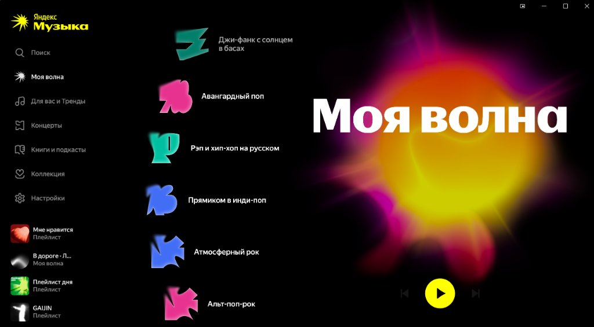

# ya.music-pro

<div align="center">


### Нативный аудиофильский десктопный плеер для Яндекс Музыки на Rust и Slint

[](https://github.com/yug33n/ya.music-pro/releases)
[](LICENSE)
[](https://www.rust-lang.org)
[](https://slint.dev)
[]()

[English](#english-summary) • [Русский](#описание)

</div>

---

## Описание

**ya.music-pro** — независимый легковесный десктопный плеер для сервиса «Яндекс Музыка». Проект ориентирован на максимальное качество звучания, низкие задержки, мгновенный отклик интерфейса и бережное отношение к системным ресурсам.

В отличие от стандартных решений на базе браузерных веб-оболочек, клиент скомпилирован в единый компактный нативный бинарный файл без Chromium и Node.js.

<div align="center">
  
</div>

---

## Сравнение с официальным клиентом

| Параметр | Официальное приложение | ya.music-pro |
| :--- | :--- | :--- |
| **Технологический стек** | Electron + Chromium + Node.js | **Rust 2021 + Slint (Skia / Software render)** |
| **Потребление ОЗУ** | 450 – 850+ МБ | **40 – 75 МБ** (~15–20 МБ в трее) |
| **Время холодного запуска** | 3 – 6 секунд | **< 200 миллисекунд** |
| **Вывод звука** | Windows Shared Audio (микшер OS) | **WASAPI Exclusive (Bit-Perfect без ресемплинга)** |
| **Аудио-процессинг (DSP)** | Базовый фиксированный эквалайзер | **10-полосный biquad EQ, LUFS (EBU R128), Slowed+Reverb** |
| **Интеграция с микрофоном / связью** | Отсутствует | **Smart Voice Ducking (автоприглушение при речи в Discord/Telegram)** |
| **Discord Rich Presence** | Требуются сторонние скрипты | **Встроенный Rich Presence с бейджами качества (Lossless / Hi-Res)** |
| **Сворачивание в трей** | Окно скрыто, браузер работает в фоне | **Ultra-light Headless Mode (полное освобождение ресурсов окна)** |
| **Кэш и локальный экспорт** | Закрытый зашифрованный кэш | **LRU-кэш на SQLite, экспорт треков с ID3-тегами и текстом LRC** |
| **Реклама и трекинг** | Встроенные промо-блоки и аналитика | **Полное отсутствие рекламы, телеметрии и трекеров** |

---

## Ключевые возможности

- **Аудиофильский звуковой тракт:**
  - Низкоуровневый вывод через CPAL с поддержкой режима WASAPI Exclusive (монопольный доступ к аудиоустройству).
  - Бесшовное переключение между треками (Gapless playback) и плавный переход Equal-Power Crossfade.
  - Аппаратная поддержка форматов FLAC (Lossless) и MP3/AAC/OGG через библиотеку Symphonia.
  - Встроенный 10-полосный параметрический эквалайзер с сохранением профилей.
  - Нормализация громкости треков по стандарту EBU R128 (LUFS).
  - Режим пространственной обработки Slowed + Reverb (алгоритмы Rubato и Stereo Freeverb).

- **Нативный интерфейс Slint:**
  - Фирменная тёмная эстетика с акцентами в янтарно-оранжевых тонах.
  - Полноценная «Моя волна» с интерактивным выбором настроения, языка и активности.
  - Разделы «Для вас и Тренды», «Концерты», «Книги и подкасты», «Коллекция» и быстрый доступ к «Настройкам» в боковом меню.
  - Полноэкранный режим с караоке (синхронизированная прокрутка LRC из каталога и базы LRCLIB).

- **Системные интеграции Windows:**
  - **Smart Voice Ducking:** фоновое отслеживание активности аудиосессий через `IAudioSessionManager2` и деликатное приглушение музыки во время звонков.
  - **Discord Rich Presence:** отображение трека, исполнителя, прогресса и иконки стриминга в профиле Discord.
  - **Глобальные горячие клавиши:** управление воспроизведением даже при работе в других окнах или играх.
  - **Автоматические обновления:** проверка свежих версий напрямую из официального репозитория `yug33n/ya.music-pro`.

---

## Установка и запуск

### Готовые бинарники
Скачайте актуальный архив или исполняемый файл в разделе [Releases](https://github.com/yug33n/ya.music-pro/releases). Приложение поставляется как единый portable `.exe` и не требует инсталляции.

### Сборка из исходников

#### Системные требования:
- Rust 1.80+ (рекомендуется тулчейн `stable-x86_64-pc-windows-msvc`)
- Git
- Microsoft C++ Build Tools (компоненты MSVC для линковки)

#### Команды сборки:
```bash
# Клонирование репозитория
git clone https://github.com/yug33n/ya.music-pro.git
cd ya.music-pro

# Сборка оптимизированного релиза
cargo build --release

# Запуск собранного приложения
./target/release/ya-music-pro.exe
```

---

## Горячие клавиши по умолчанию

| Сочетание | Действие |
| :--- | :--- |
| `Пробел` | Воспроизведение / Пауза |
| `Ctrl + Вправо` | Следующий трек |
| `Ctrl + Влево` | Предыдущий трек |
| `Ctrl + Вверх` | Увеличение громкости |
| `Ctrl + Вниз` | Уменьшение громкости |
| `Ctrl + L` | Добавить в любимые треки / убрать лайк |
| `F11` | Полноэкранный режим с текстом песни |
| `Esc` | Выход из полноэкранного режима / закрытие модальных окон |

---

## Планы по развитию (Roadmap)

- [ ] **ASIO Engine:** прямая поддержка профессиональных ASIO-драйверов для внешних ЦАП и студийных аудиокарт.
- [ ] **Поддержка VST3 плагинов:** возможность подключения пользовательских аудиоэффектов и виртуальных процессоров.
- [ ] **Скробблинг:** интеграция с сервисами Last.fm и ListenBrainz.
- [ ] **Desktop Lyrics Overlay:** компактный плавающий оверлей с текстом поверх всех окон.
- [ ] **Настраиваемые темы и визуализаторы:** выбор цветовых палитр интерфейса и реактивные шейдеры для «Моей волны».
- [ ] **Кроссплатформенность:** официальная сборка под Linux (PipeWire / ALSA) и macOS (CoreAudio).

---

## English Summary

**ya.music-pro** is an ultra-fast, native, audiophile desktop client for Yandex Music built in Rust and Slint GUI. It replaces heavy web wrappers with direct hardware audio rendering (WASAPI Exclusive Bit-Perfect), consumes only ~40–75 MB of RAM, starts in under 200 ms, and includes advanced DSP capabilities (10-band biquad EQ, LUFS normalization, voice ducking during Discord/Telegram calls, and Discord Rich Presence).

---

## Лицензия и отказ от ответственности

Проект распространяется под условиями лицензии [MIT](LICENSE).

> **Дисклеймер:**  
> Данное программное обеспечение является независимой разработкой с открытым исходным кодом и не аффилировано с компанией Яндекс. Все товарные знаки, логотипы и названия музыкальных сервисов принадлежат их законным владельцам.
